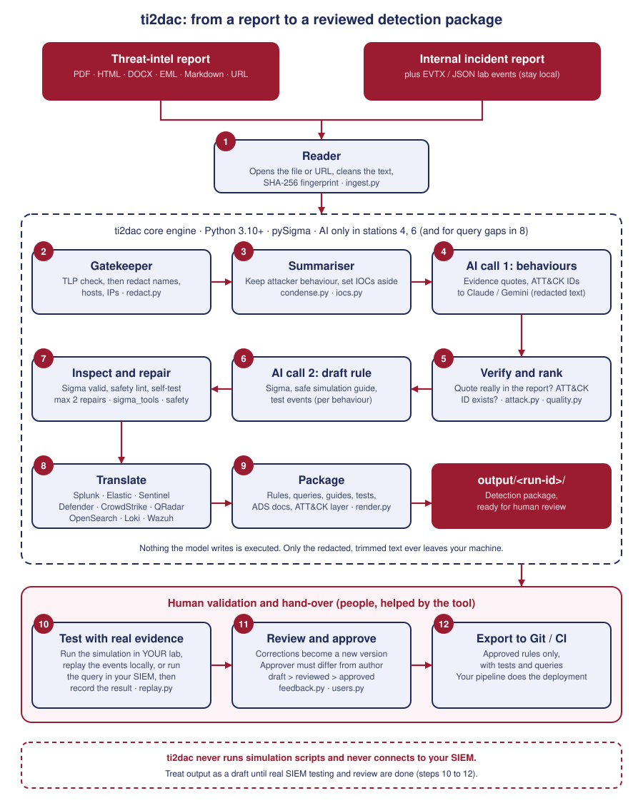
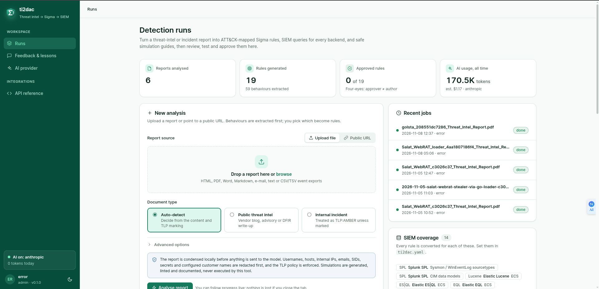
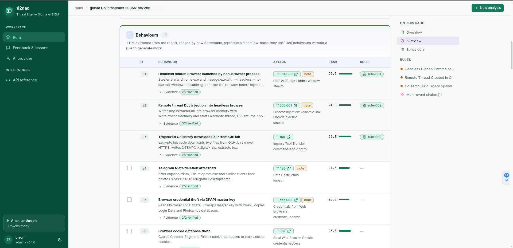

# ti2dac: Threat Intelligence → Detection-as-Code

ti2dac turns a **threat-intelligence report or an internal incident report** into a reviewed, tested detection package:

- the attacker behaviours (TTPs) in the report, with evidence quotes checked against the source and verified MITRE ATT&CK mappings
- one vendor-neutral **Sigma** rule per behaviour (single-event or threshold/correlation), validated with pySigma
- the same rule as native queries for **Splunk, Elastic, Microsoft Sentinel, Defender XDR, CrowdStrike NG-SIEM, QRadar, OpenSearch and Grafana Loki**, with a per-SIEM field-mapping table
- a **simulation and test guide** per rule: a safe lab script and its cleanup, the matching Atomic Red Team test, expected events, and positive and false-positive test procedures
- **unit tests** for each rule, plus local replay of real lab or incident logs, so you know a rule fires *before* it reaches a SIEM
- **ADS** triage documentation, telemetry requirements, a validation matrix and an ATT&CK Navigator layer
- a **feedback and review workflow**: error taxonomy, versioned corrections, lessons fed back into the AI, four-eyes approval and an audit log

The AI does the reading and the detection writing. Everything that can be deterministic is deterministic: conversion,
validation, documentation, safety checks and redaction. This keeps token use low and the output reproducible.



*Steps 1 to 9 run automatically. Steps 10 to 12 are done by people: ti2dac never runs the simulation scripts and never connects to your SIEM.*

## Install

Requires Python 3.10 or newer.

```bash
pip install ti2dac            # or: pipx install ti2dac
pip install "ti2dac[gemini]"  # optional: Google Gemini as the AI provider
pip install "ti2dac[evtx]"    # optional: replay Windows .evtx evidence
```

## Quick start

From a source checkout (`git clone https://github.com/Sazidul0/TI2DaC && cd TI2DaC`):

```bash
uv venv .venv && uv pip install --python .venv/bin/python -e ".[dev]"
cp .env.example .env                         # then add ANTHROPIC_API_KEY (see docs/getting-started.md)
cp ti2dac.example.yaml ti2dac.yaml           # then set your domains, customer names, telemetry

ti2dac run path/to/report.html               # public threat-intel report (file or URL)
ti2dac run IR-2026-0147.docx --incident --events host-sysmon.evtx   # internal incident report + its evidence logs
ti2dac serve                                 # web UI on http://127.0.0.1:8000
```

The two-step flow lets an analyst choose behaviours before any rule-generation tokens are spent:

```bash
ti2dac analyze report.html                   # 1 AI call: behaviours ranked as B1..Bn
ti2dac generate <run-id> --select B2,B5      # 1 AI call per chosen behaviour
```

Without AI (`--no-ai` or `TI2DAC_NO_AI=1`), the deterministic parts still work: ingestion, IOC extraction,
cited ATT&CK IDs, and validation, conversion, unit tests and replay of hand-written rules.

## Web UI

`ti2dac serve` starts a local web UI (bound to `127.0.0.1`) for analysts and reviewers, with logins and roles.



*The Runs page: upload a report or paste a URL, choose the document type, and follow recent jobs and totals.*



*A run: behaviours extracted from the report, ranked, with checked evidence quotes and ATT&CK mappings. Tick any behaviour without a rule to generate more.*

## Safety at a glance

- **Your data stays home.** The AI sees only trimmed, redacted text. Names, hosts, internal IPs, emails and secrets are replaced with placeholders first. TLP:RED documents never go to an AI.
- **Nothing is executed.** Simulation scripts are linted for destructive or credential-stealing actions, and the tool never runs them. Nothing the model writes is run.
- **Nothing is trusted unchecked.** Evidence quotes, ATT&CK IDs, Sigma syntax and rule self-tests are verified by code before you see a rule.
- **People stay in charge.** The tool drafts. A second person (the approver) must approve what the author created, and only approved rules are exported.

Generated rules are drafts until you have tested them on real events. See [known limitations](https://github.com/Sazidul0/TI2DaC/blob/main/docs/known-limitations.md).

## Documentation

| Guide | What is in it |
|---|---|
| [Getting started](https://github.com/Sazidul0/TI2DaC/blob/main/docs/getting-started.md) | AI provider setup, a step-by-step walk-through, supported inputs |
| [How it works](https://github.com/Sazidul0/TI2DaC/blob/main/docs/how-it-works.md) | Architecture in plain terms, the working process, how tokens are kept low |
| [Quality, safety and testing](https://github.com/Sazidul0/TI2DaC/blob/main/docs/quality-and-testing.md) | Safety controls and the three levels of proving a rule works |
| [SIEM coverage](https://github.com/Sazidul0/TI2DaC/blob/main/docs/siem-coverage.md) | All SIEM targets, Wazuh, correlations and client profiles |
| [Review and configuration](https://github.com/Sazidul0/TI2DaC/blob/main/docs/governance-and-config.md) | Feedback, four-eyes approval, Git hand-off, `ti2dac.yaml` |
| [Operations](https://github.com/Sazidul0/TI2DaC/blob/main/docs/operations.md) | Monitoring, web UI security, output package layout |
| [CLI reference](https://github.com/Sazidul0/TI2DaC/blob/main/docs/cli-reference.md) | Every command |
| [Known limitations](https://github.com/Sazidul0/TI2DaC/blob/main/docs/known-limitations.md) | What the tool does not do yet |

## Development

```bash
.venv/bin/python -m pytest -q      # 254 tests, no network or API key needed
```

Dependency pins that matter: pySigma must stay `0.11.x`, because the QRadar backend breaks on 2.x and newer
SQLite-backend releases silently pull in pySigma 2. `pyparsing` must stay below 3.2, which pySigma 0.11's condition
parser needs. `pySigma-backend-sqlite` must be `0.2.0`. `regex` and `dateparser` are pinned together (see `pyproject.toml`).

## License

MIT. See [LICENSE](https://github.com/Sazidul0/TI2DaC/blob/main/LICENSE).
